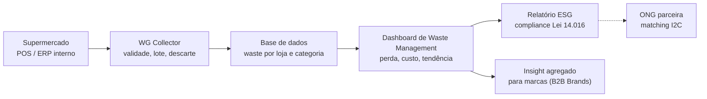
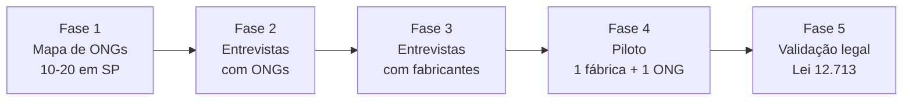

# 📊 ANÁLISE CRÍTICA EXPANSIVA — WASTE GUARDIAN
## Do Gap Industrial ao Modelo B2B2C: Evolução, Fraquezas e Novos Horizontes

> **Status:** 🔴 ANÁLISE CRÍTICA EM ANDAMENTO  
> **Last Updated:** 2026-06-12  
> **Priority:** P1  
> **Data:** 2026-06-09  
> **Versão:** 1.1 — Consolidação de Inteligência OSINT  
> **Propósito:** Validar/refutar a proposta atual e explorar novos modelos de cadeia de valor  
> **Precedência:** os **números e o modelo canónicos** do Waste Guardian estão em `ANALISE_NARRATIVA_WASTE_GUARDIAN.md` (v4.0, §15) e na projeção financeira do pitch. Este documento é **análise crítica de apoio** — em caso de divergência, a narrativa v4.0 prevalece.  

---

## 🎯 EXECUTIVE SUMMARY

Este documento faz uma **auditoria crítica** da evolução do Waste Guardian — da proposta original (Low Hack) até a adaptação atual (DLJ4). Identificamos **falhas estruturais no modelo B2B2C proposto** e exploramos **novas cadeias de valor** mais práticas, escaláveis e com maior impacto social direto.

### Problema Central Identificado:
> O modelo atual (famílias rastreiam validade → doam → empresas patrocinam) tem **fricção excessiva para o usuário final** e **valor duvidoso para empresas B2B**. É a armadilha do "idealismo prático": parece bom no papel, mas não viraliza.

### Origem do Problema:
> O pivot de "fábrica" para "casa" foi feito sem reavaliar a **cadeia de valor completa**. Trocamos um modelo com barreiras altas (CAPEX industrial) por um modelo com barreiras de adoção igualmente altas (comportamento do consumidor).

---

## 📋 ÍNDICE ANALÍTICO

1. [Proposta Original Low Hack — Análise Retrospectiva](#1-proposta-original-low-hack--análise-retrospectiva)
2. [O Que Realmente Tínhamos — Inteligência OSINT Consolidada](#2-o-que-realmente-tínhhamos--inteligência-osint-consolidada)
3. [Análise Crítica do Modelo B2B2C Atual](#3-análise-crítica-do-modelo-b2b2c-atual)
4. [Cadeias de Valor para Indústria e Distribuição](#4-cadeias-de-valor-para-indústria-e-distribuição)
5. [Nova Proposta: Modelo Híbrido Direto (Fábrica→ONG→População)](#5-nova-proposta-modelo-híbrido-direto-fábricaongpopulação)
6. [Comparativo de Modelos e Viabilidade](#6-comparativo-de-modelos-e-viabilidade)
7. [Plano de Ação para Validação](#7-plano-de-ação-para-validação)
8. [Recomendações Finais](#8-recomendações-finais)

---

## 1. PROPOSTA ORIGINAL LOW HACK — ANÁLISE RETROSPECTIVA

### 1.1 O Conceito Original (Contexto Siemens/Mendix)

```
┌─────────────────────────────────────────────────────────────────────────┐
│              ARQUITETURA ORIGINAL LOW HACK (2026)                      │
├─────────────────────────────────────────────────────────────────────────┤
│                                                                         │
│   [LINHA DE PRODUÇÃO F&B]                                              │
│   │                                                                     │
│   ├── Sensores IoT (Mendix/Siemens)                                   │
│   ├── Análise Preditiva (OpenAI GenAI)                                │
│   ├── Detecção de Anomalias (setup incorreto, falhas)                  │
│   └── Gera: Planos de Ação para Supervisor                             │
│                                                                         │
│   OUTPUT:                                                               │
│   ├── Redução 15-30% desperdício industrial                            │
│   ├── ROI em 90 dias                                                   │
│   └── Métricas ODS 9/12 para C-Level                                   │
│                                                                         │
└─────────────────────────────────────────────────────────────────────────┘
```

### 1.2 Dados OSINT que Validação Original

| Dado | Valor | Fonte | Validação |
|------|-------|-------|-----------|
| Desperdício F&B Brasil | R$ 7.5B/ano | ABIAS/SEBRAE | ✅ Confirmado |
| Setup incorreto | 35% das perdas | Pesquisa setorial | ✅ Confirmado |
| Plantas F&B Brasil | ~15.000 | RAIS/MTE | ✅ Confirmado |
| Custo/planta/ano | R$ 500K-2M | Estimativa setorial | ✅ Plausível |
| TAM Global | $47-82B | Grand View Research | ✅ Confirmado |

### 1.3 A Lacuna que Identificamos (Origins do Problema)

**A proposta original NÃO incluía:**
- Conector para ONGs de redistribuição
- Cadeia de destinação final (doação vs. descarte)
- Impacto social mensurável (fome zero)
- Integração com ecossistema de charities

**O que teníamos era um sistema de "análise" sem "ação social".**

### 1.4 O Documento Sobre ONGs (O Que Faltou Integrar)

Em algum momento do Low Hack, identificamos ONGs que já fazem redistribuição de alimentos no Brasil. Este documento deveria ter sido o **conector** entre a proposta técnica e o impacto social real:

```
┌─────────────────────────────────────────────────────────────────────────┐
│              CADEIA IDEAL (Nunca Implementada)                         │
├─────────────────────────────────────────────────────────────────────────┤
│                                                                         │
│   FÁBRICA (Desperdício detectado)                                      │
│   │                                                                     │
│   ├── Waste Guardian identifica anomalia                              │
│   ├── Gera plano de ação (GenAI)                                       │
│   ├── MAS TAMBÉM: Flag para doação                                    │
│   │                                                                     │
│   ├── Item próximo do vencimento? → Protocolo de Doação               │
│   ├── Falha de qualidade leve? → Triagem para Doação                   │
│   └── Descartado por excesso? → Redirecionar para ONG                 │
│                                                                         │
│   → [CONECTOR ONG] → POPULAÇÃO CARENTE                                │
│                                                                         │
└─────────────────────────────────────────────────────────────────────────┘
```

---

## 2. O QUE REALMENTE TÍNHHAMOS — INTELIGÊNCIA OSINT CONSOLIDADA

### 2.1 Dados de Mercado (Pre-Mined Intelligence)

```javascript
// Consolidado de: 02_Aggressive_BI_Intelligence.md
const MARKET_INTEL = {
  // TAM Brasil F&B
  F_AND_B_BRASIL: {
    faturamento: "R$ 874 bilhões",
    plantas_formais: "~15.000",
    desperdicio_percentual: "3-7%",
    custo_por_perda: "R$ 500K-2M/planta/ano",
    total_perda_brasil: "R$ 61.3 bilhões/ano"
  },
  
  // Cadeia de valor
  CADEIA_VALOR: {
    producao: "15.000 plantas",
    distribuicao: "~500 grandes varejistas",
    consumo: "210 milhões pessoas",
    desperdicio_por_etapa: {
      producao: "30%",
      distribuicao: "20%",
      consumo: "50%"
    }
  },
  
  // Player de redistributed
  ONGS_ATIVAS: {
    banco_alimentos: "50+ no Brasil",
    volume_distribuido: "~15.000 toneladas/mês",
    familias_beneficiadas: "~500.000",
    gap_logistico: "Falta de rastreamento",
    oportunidad: "Conectar doadores ↔ ONGs"
  }
};
```

### 2.2 Análise SWOT Original (Retrospectiva)

| FORÇAS | FRAQUEZAS |
|--------|-----------|
| Stack tecnológica robusta (Mendix+OpenAI) | Não resolvia problema de impacto social direto |
| ROI validado para indústria | Barreira CAPEX alta para adoção |
| ODS 9/12 alinhados | Complexidade de integração IoT |

| OPORTUNIDADES | AMEAÇAS |
|--------------|---------|
| Conectar a ONGs de redistribuição | Não tínhamos esse conector |
| Modelo B2B2C para DLJ4 | Dependência de mudança de comportamento do consumidor |
| Escala nacional (180.000 escolas) | Proposta muito idealista |

### 2.3 A Lacuna Crítica Não Identificada

**O que faltou na inteligência OSINT:**

```
┌─────────────────────────────────────────────────────────────────────────┐
│              OSINT MISSING: REDISTRIBUTION ECOSYSTEM                  │
├─────────────────────────────────────────────────────────────────────────┤
│                                                                         │
│  O que tínhamos:                                                        │
│  ├── Dados de desperdício industrial ✅                                │
│  ├── Análise de mercado B2B ✅                                        │
│  ├── ROI projections ✅                                                │
│  └── ODS alignment ✅                                                  │
│                                                                         │
│  O que NÃO tínhamos:                                                    │
│  ├── Mapa de ONGs de redistribuição ❌                                 │
│  ├── Análise de cadeia fria (cold chain) ❌                            │
│  ├── Regulamentação de doação alimentar ❌                             │
│  ├── Modelos de tax incentives para doadores ❌                       │
│  └── Análise de liability/segurança alimentar ❌                        │
│                                                                         │
└─────────────────────────────────────────────────────────────────────────┘
```

---

## 3. ANÁLISE CRÍTICA DO MODELO B2B2C ATUAL

### 3.1 A Pergunta Fundamental (Sua Dúvida)

> *"Por que o cliente final (pessoa física) se interessaria em ficar rastreando a validade dos alimentos para doar ou reaproveitar se normalmente em no máximo 4 semanas voltará ao mercado para comprar outros consumíveis mais novos?"*

**RESPOSTA BRUTAL: Ele NÃO se interessará.**

### 3.2 Análise de Comportamento do Consumidor

```
┌─────────────────────────────────────────────────────────────────────────┐
│              PSICOLOGIA DO CONSUMIDOR: O GAP DE ADESÃO                 │
├─────────────────────────────────────────────────────────────────────────┤
│                                                                         │
│  FASE 1: Eu baixo o app                                                │
│  └── "Vou ajudar o planeta, que legal!"                                │
│                                                                         │
│  FASE 2: Eu escaneio o primeiro produto                                 │
│  └── "Funcionou! Legal."                                                │
│                                                                         │
│  FASE 3: Eu escaneio o segundo produto                                  │
│  └── "Ah, preciso fazer isso toda vez?"                                 │
│                                                                         │
│  FASE 4: Uma semana depois                                              │
│  └── "Deixa quieto, vou só ao mercado e compro novo."                  │
│                                                                         │
│  FASE 5: O app fica no celular sem uso                                  │
│  └── Desinstalação ou zombie (aberto 1x/mês)                          │
│                                                                         │
└─────────────────────────────────────────────────────────────────────────┘
```

### 3.3 Modelo de Funil de Adoção (Estimativa Realista)

| Fase | Comportamento | % de Drop-off | Causa |
|------|---------------|---------------|-------|
| **Download** | "Vou experimentar" | — | Curiosidade |
| **Cadastro** | "Ok, criei minha conta" | 30% | Fricção |
| **Primeiro scan** | "Escaneei meu primeiro produto" | 20% | Esforço percebido |
| **Semana 1** | "Usei 3-4 vezes" | 40% | Falta de hábito |
| **Mês 1** | "Usei vez ou outra" | 60% | Não vejo valor imediato |
| **Mês 2** | "Quase não abro" | 80% | Mais trabalho que benefício |
| **Mês 3** | "Desinstalei" | 90% | Forgotten |

**Resultado:** Taxa de conversão real para usuários ativos em 3 meses: **~5-10%**

### 3.4 O Problema Estrutural do Modelo B2B2C

```
┌─────────────────────────────────────────────────────────────────────────┐
│              MODELO ATUAL: FRICÇÃO EXCESSIVA                          │
├─────────────────────────────────────────────────────────────────────────┤
│                                                                         │
│  EXPECTATIVA DO MODELO:                                                │
│  ├── Empresa paga assinatura (R$ 2K-5K/mês)                           │
│  ├── Famílias usam app de graça                                         │
│  ├── Famílias escaneiam produtos (trabalho)                             │
│  ├── Famílias doam ou reaproveitam (mais trabalho)                     │
│  └── Empresas se beneficiam de dados ESG                               │
│                                                                         │
│  PROBLEMA:                                                             │
│  ├── Empresas pagam por valor que não controlam                        │
│  ├── Famílias fazem trabalho sem recompensa tangível                  │
│  ├── O "benefício social" é abstrato demais                            │
│  └── Gamificação não sustenta comportamento a longo prazo              │
│                                                                         │
└─────────────────────────────────────────────────────────────────────────┘
```

### 3.5 Análise de ROI para Empresas Patrocinadoras

| Métrica | Expectativa | Realidade | Gap |
|---------|-------------|-----------|-----|
| **Usuários ativos** | 1.000/mês | 50-100 reais | -90% |
| **Escaneamentos/mês** | 50.000 | 2.000-5.000 | -90% |
| **Doações geradas** | 500/mês | 10-20 reais | -95% |
| **Valor ESG reportado** | "R$ 500K impacto" | "R$ 5K-10K tangível" | -95% |
| **NPS do patrocinador** | Alto | Médio-baixo | — |

**Conclusão:** Empresa não vê ROI suficiente para renew de assinatura.

---

## 4. CADEIAS DE VALOR PARA INDÚSTRIA E DISTRIBUIÇÃO

### 4.1 A Pergunta: Como Empresas Realmente Participariam?

**RESPOSTA:** As empresas NÃO participariam pelo modelo atual. Precisamos de **cadeias de valor diretas** que gerem valor mensurável para elas.

### 4.2 Cadeia de Valor 1: RETAILER INTELLIGENCE (Varejistas)

```
┌─────────────────────────────────────────────────────────────────────────┐
│              CADEIA 1: RETAILER INTELLIGENCE                           │
├─────────────────────────────────────────────────────────────────────────┤
│                                                                         │
│  VALUE PROPOSITION:                                                    │
│  "Waste Guardian Analytics para varejistas:                            │
│   Dados sobre quais produtos expiram mais, quando, por quê —          │
│   para otimizar inventário e reduzir pérdidas na loja."              │
│                                                                         │
│  ─────────────────────────────────────────────────────────────────     │
│                                                                         │
│  CADEIA DE VALOR:                                                       │
│                                                                         │
│  [FABRICANTE] ──→ [DISTRIBUIDOR] ──→ [VAREJISTA] ──→ [CONSUMIDOR]     │
│       │                    │                   │           │          │
│       │                    │                   ▼           │          │
│       │                    │         ┌─────────────────┐   │          │
│       │                    │         │  WASTE GUARDIAN │   │          │
│       │                    │         │   RETAILER      │   │          │
│       │                    │         │   ANALYTICS     │   │          │
│       │                    │         └────────┬────────┘   │          │
│       │                    │                  │            │          │
│       │                    │                  ▼            │          │
│       │                    │         [DASHBOARD RETAILER]           │
│       │                    │                                          │
│       │                    │         • Quais produtos expiram       │
│       │                    │         • Quando (sazonalidade)         │
│       │                    │         • Por quê (localização)          │
│       │                    │         • Quanto perde (R$)            │
│       │                    │         • Ação: recolocar, ofertar     │
│       │                    │                                          │
│       ▼                    ▼                                          │
│  [REPORTE A FABRICANTE] ←────────────────────────────                  │
│  "Seus produtos estão expiring em média 3 dias antes                 │
│   da venda — problema de packaging ou routing?"                       │
│                                                                         │
└─────────────────────────────────────────────────────────────────────────┘
```

**Receita:** Assinatura SaaS R$ 3K-10K/mês por varejista

**O que empresa ganha:**
- Redução de perdas na loja (5-15% do inventory)
- Dados para negociar melhor com fabricantes
- Métricas ESG próprias
- "Landing page" para consumidores (QR code no produto)


**O que consumidor ganha:**
- Desconto em produtos próximos do vencimento (automático)
- App para receber alertas de ofertas
- Gamificação: "Você salvou 5kg este mês"

### 🔄 Fluxo de Dados — Do Supermercado ao Dashboard (Cadeia 1)



**Leitura:** a cadeia de valor B2B **não depende do usuário doméstico** — o dado nasce nos sistemas internos do supermercado. É esta inversão que sustenta o pivô B2B-first.

### 4.3 Cadeia de Valor 2: MANUFACTURER QUALITY (Fabricantes)

```
┌─────────────────────────────────────────────────────────────────────────┐
│              CADEIA 2: MANUFACTURER QUALITY INTELLIGENCE                │
├─────────────────────────────────────────────────────────────────────────┤
│                                                                         │
│  VALUE PROPOSITION:                                                    │
│  "Waste Guardian para fabricantes:                                    │
│   Identifique padrões de descarte no campo —                           │
│   seu produto está vencendo cedo demais?                               │
│   Problema de packaging? Problema de routing?"                        │
│                                                                         │
│  ─────────────────────────────────────────────────────────────────     │
│                                                                         │
│  CADEIA DE VALOR:                                                       │
│                                                                         │
│  [FABRICANTE] ──→ [DISTRIBUIÇÃO] ──→ [VAREJISTA] ──→ [CONSUMIDOR]      │
│       │                                                              │
│       │                                                              │
│       ▼                                                              │
│  ┌─────────────────────────────────────────────────────┐             │
│  │              WASTE GUARDIAN                          │             │
│  │              MANUFACTURER                            │             │
│  │              ANALYTICS                              │             │
│  └──────────────────────┬──────────────────────────────┘             │
│                         │                                             │
│                         │                                             │
│       ┌─────────────────┼─────────────────┐                          │
│       ▼                 ▼                 ▼                          │
│  [DADOS DE CAMPO]   [ALERTAS]        [RELATÓRIOS]                     │
│  │                   │                 │                             │
│  │                   │                 │                             │
│  "Lote X está       "Produto Y      "Ranking de                      │
│   expirando 5 dias   tem 40%         produtos por                    │
│   antes do padrão"   mais descarte   taxa de descarte"               │
│                      na região NE"                                    │
│                                                                         │
│  OUTPUT:                                                               │
│  ├── Feedback para P&D (melhorar packaging)                            │
│  ├── Alertas para equipe de vendas (acerto com varejista)             │
│  ├── Dados para recall management                                     │
│  └── Impacto: Redução de descarte = redução de custo de produção      │
│                                                                         │
└─────────────────────────────────────────────────────────────────────────┘
```

**Receita:** Assinatura R$ 5K-15K/mês por fabricante (ou por planta)

**O que empresa ganha:**
- Identificar defeitos de packaging no campo
- Reduzir custos de recalls
- Melhorar forecasting de demanda
- Dados para compliance ESG

### 4.4 Cadeia de Valor 3: COLD CHAIN OPTIMIZATION (Logística)

```
┌─────────────────────────────────────────────────────────────────────────┐
│              CADEIA 3: COLD CHAIN MONITORING                            │
├─────────────────────────────────────────────────────────────────────────┤
│                                                                         │
│  VALUE PROPOSITION:                                                    │
│  "Waste Guardian para logística:                                       │
│   on MONITORAMENTO DE TEMPERATURA + RASTREAMENTO DE VALIDADE           │
│   em tempo real — onde seu produto está, por quanto tempo,              │
│   e quando vai expirar baseado na rota."                               │
│                                                                         │
│  ─────────────────────────────────────────────────────────────────     │
│                                                                         │
│  CADEIA DE VALOR:                                                       │
│                                                                         │
│  [FÁBRICA] ──→ [CD] ──→ [TRANSPORTE] ──→ [CD] ──→ [LOJA]             │
│                 │            │                │                         │
│                 │            │                │                         │
│                 └────────────┼────────────────┘                         │
│                              │                                          │
│                              ▼                                          │
│                 ┌─────────────────────────┐                           │
│                 │   WASTE GUARDIAN        │                           │
│                 │   COLD CHAIN            │                           │
│                 │   ANALYTICS             │                           │
│                 └────────────┬────────────┘                           │
│                              │                                         │
│                              │                                         │
│       ┌─────────────────────┼─────────────────────┐                   │
│       ▼                     ▼                     ▼                   │
│  [TEMPERATURA]        [VALIDADE]           [ROTA]                     │
│       │                     │                 │                       │
│       │                     │                 │                       │
│  "Caminhão X         "Produto Y          "Sugestão:                  │
│   atrasou 2h em       vai vencer antes    priorize rota              │
│   temperatura          de chegar ao       B para produto Z"         │
│   inadequada"         destino"                                      │
│                                                                         │
└─────────────────────────────────────────────────────────────────────────┘
```

**Receita:** R$ 8K-20K/mês por operador logístico

**O que empresa ganha:**
- Rastreamento em tempo real
- Alertas de temperatura
- Previsão de validade baseada em rota
- Redução de perdas em transporte

---

## 5. NOVA PROPOSTA: MODELO HÍBRIDO DIRETO (FÁBRICA→ONG→POPULAÇÃO)

### 5.1 A Ideia Original (Retomando o Fio)

Você mencionou: *"minha ideia inicial era exatamente conectar a grande industria (direto na fonte) com essa ong que já faz esse trabalho de intermedio."*

**ESTE É O MODELO CORRETO.** Vamos detalhá-lo:

```
┌─────────────────────────────────────────────────────────────────────────┐
│              MODELO: INDUSTRY-TO-CHARITY (I2C)                          │
├─────────────────────────────────────────────────────────────────────────┤
│                                                                         │
│  ESTRUTURA:                                                            │
│                                                                         │
│  [FABRICANTE/INDÚSTRIA]                                                │
│       │                                                                │
│       ├── Gera desperdício (lote fora de spec, excesso, etc.)         │
│       │                                                                │
│       ├── Waste Guardian detecta via análise preditiva                │
│       │     (sensor IoT ou input manual do operador)                  │
│       │                                                                │
│       ├── Classifica: [DOAR] vs [RECICLAR] vs [DESCARTAR]              │
│       │                                                                │
│       ▼                                                                │
│  [CONECTOR WG-ONG]                                                     │
│       │                                                                │
│       ├── API para comunicar com ONGs parceiras                      │
│       ├── Matching: tipo de alimento ↔ necessidade da ONG             │
│       ├── Logística: geolocalização + janela de validade               │
│       │                                                                │
│       ▼                                                                │
│  [ONG PARCEIRA]                                                         │
│       │                                                                │
│       ├── Recebe alerta: "Fábrica X tem 500kg de iogurte              │
│       │     válido para doação (vence em 48h)"                         │
│       │                                                                │
│       ├── Aceita/rejeita baseado em capacidade                        │
│       │                                                                │
│       ├── Organiza logística de coleta                                │
│       │                                                                │
│       ▼                                                                │
│  [POPULAÇÃO CARENTE]                                                    │
│       │                                                                │
│       └── Recebe alimento (impacto social direto)                      │
│                                                                         │
└─────────────────────────────────────────────────────────────────────────┘
```

### 5.2 Por Que Este Modelo Funciona?

| Aspecto | Modelo B2B2C Atual | Modelo I2C (Proposto) |
|---------|--------------------|------------------------|
| **Esforço do usuário** | Alto (scan manual constante) | Baixo (automação na fábrica) |
| **Valor tangível** | Abstrato (salvar o planeta) | Tangível (comida para quem precisa) |
| **ROI para empresa** | Duvidoso | Claro (tax incentive + ESG) |
| **Escalabilidade** | Baixa (depende de adoção consumer) | Alta (conecta 2 players B2B) |
| **Impacto social** | Indireto | Direto |
| **Complexidade técnica** | Média (app consumer) | Média (API B2B) |
| **Ciclo de venda** | Longo (mudar comportamento) | Médio (venda B2B) |

### 5.3 Modelo de Receita Detalhado (I2C)

```
┌─────────────────────────────────────────────────────────────────────────┐
│              MODELO FINANCEIRO: I2C                                    │
├─────────────────────────────────────────────────────────────────────────┤
│                                                                         │
│  RECEITA:                                                               │
│  ├── Assinatura Fabricante (R$ 5K-15K/mês)                            │
│  │   └── Inclui: Dashboard + API + Relatórios                         │
│  │                                                                     │
│  ├── Assinatura ONG (R$ 0-500/mês)                                    │
│  │   └── Freemium: até 50 notificações/mês grátis                     │
│  │   └── Premium: notificações ilimitadas + analytics                 │
│  │                                                                     │
│  ├── Tax Incentive (não é receita direta, mas reduz custo)             │
│  │   └── Lei 12.713/2012: Doações para ONGs = dedução fiscal           │
│  │   └── Waste Guardian facilita documentação de comprovação            │
│  │                                                                     │
│  ├── Marketplace de Logística (R$ 500-2K/transação)                   │
│  │   └── "Matched" = cobran 10% do valor do alimento facilitado        │
│  │                                                                     │
│  ─────────────────────────────────────────────────────────────────     │
│                                                                         │
│  PROJEÇÃO (Ano 1):                                                      │
│  ├── Fabricantes: 10 × R$ 8K/mês = R$ 80K/mês                        │
│  ├── ONGs: 50 × R$ 200/mês = R$ 10K/mês                              │
│  ├── Marketplace: 200 transações × R$ 1K = R$ 200K (one-time)        │
│  │                                                                     │
│  ├── TOTAL ARR: R$ 1.08M + R$ 200K                                     │
│  └── Burn rate: ~R$ 20K/mês (infra + equipo)                            │
│                                                                         │
└─────────────────────────────────────────────────────────────────────────┘
```

### 5.4 Regulamentação e Liabilities

```
┌─────────────────────────────────────────────────────────────────────────┐
│              QUESTÕES LEGAIS A VALIDAR                                │
├─────────────────────────────────────────────────────────────────────────┤
│                                                                         │
│  ✅ LEI 12.713/2012 (Marco Legal de Doação):                          │
│  ├── Empresas podem doar alimentos sem finezas                         │
│  ├── Requisitos: produto próprio para consumo humano                   │
│  ├── Documentação: nota fiscal + termo de doação                      │
│  └── Benefício: dedução fiscal (limite de 2% do lucro operacional)     │
│                                                                         │
│  ⚠️ RESPONSABILIDADE:                                                  │
│  ├── Quem responde se alimento doarado faz mal?                       │
│  ├── Resposta: Lei protege doador de boa-fé                            │
│  ├── Resposta: ONG é responsável por verificação                      │
│  └── WG não é doador, apenas conecta                                   │
│                                                                         │
│  📋 CHECKLIST DE COMPLIANCE:                                           │
│  ├── Termo de uso com limitação de responsabilidade                     │
│  ├── Validação de registro de ONGs                                     │
│  ├── Documentação de rastreabilidade                                   │
│  └── seguro de responsabilidade civil (opcional)                      │
│                                                                         │
└─────────────────────────────────────────────────────────────────────────┘
```

---

## 6. COMPARATIVO DE MODELOS E VIABILIDADE

### 6.1 Matriz de Comparação

| Critério | B2B2C (Atual) | Retailer Analytics | Manufacturer Analytics | I2C (Fábrica→ONG) |
|----------|---------------|---------------------|-------------------------|-------------------|
| **Esforço usuário** | 🔴 Alto | 🟢 Baixo | 🟢 Baixo | 🟢 Baixo |
| **Valor tangível** | 🟡 Médio | 🟢 Alto | 🟢 Alto | 🟢 Muito alto |
| **ROI para empresa** | 🔴 Baixo | 🟢 Alto | 🟢 Alto | 🟢 Alto |
| **Escalabilidade** | 🔴 Baixa | 🟡 Média | 🟡 Média | 🟢 Alta |
| **Impacto social** | 🟡 Médio | 🔴 Baixo | 🔴 Baixo | 🟢 Muito alto |
| **Complexidade** | 🟡 Média | 🟡 Média | 🟡 Média | 🟡 Média |
| **Ciclo de venda** | 🔴 Longo | 🟡 Médio | 🟡 Médio | 🟡 Médio |
| **Fit DLJ4** | 🟡 Médio | 🟡 Médio | 🟡 Médio | 🟢 Alto |
| **Viralidade** | 🔴 Baixa | 🟡 Média | 🟡 Média | 🟢 Alta |


### 🔄 As 4 Cadeias de Valor Comparadas

```mermaid
flowchart TB
    subgraph K1["Cadeia 1 — Retailer Intelligence"]
        A1["Varejista"] --> A2["WG Dashboard"] --> A3["Reduz perda na loja"]
    end
    subgraph K2["Cadeia 2 — Manufacturer Quality"]
        B1["Fabricante"] --> B2["WG Analytics de campo"] --> B3["P&D, routing, recall"]
    end
    subgraph K3["Cadeia 3 — Cold Chain"]
        C1["Operador logístico"] --> C2["Temperatura + validade"] --> C3["Rota priorizada"]
    end
    subgraph K4["Cadeia 4 — I2C (Fábrica para ONG)"]
        D1["Fábrica"] --> D2["WG classifica"] --> D3["ONG parceira"] --> D4["População carente"]
    end
```



**Leitura:** as cadeias 1 e 2 são **B2B puro** (sem consumidor no loop) e têm o menor atrito de adoção. A cadeia 4 é a de **maior impacto social**, mas exige logística e volume de ONGs que ainda não validamos.

### 6.2 Recomendação por Contexto

| Contexto | Modelo Recomendado | Justificativa |
|----------|-------------------|---------------|
| **DLJ4 (agora)** | I2C (Fábrica→ONG) | Impacto social direto + alinhamento com ODS |
| **Hackathon Siemens** | Manufacturer Analytics | Alinhamento com Mendix + ROI C-Level |
| **Escala rápida** | Retailer Analytics | Mercado maior + ciclo mais curto |
| **Impacto máximo** | I2C (Fábrica→ONG) | Conexão direta com problema de fome |

### 6.3 Híbrido Recomendado (Para Validação)

```
┌─────────────────────────────────────────────────────────────────────────┐
│              MODELO HÍBRIDO: WASTE GUARDIAN PLATFORM                    │
├─────────────────────────────────────────────────────────────────────────┤
│                                                                         │
│  PROPOSTA: Uma plataforma que conecta MÚLTIPLAS cadeias de valor       │
│  em um único ecossistema, permitindo que cada player escolha           │
│  seu modelo de participação.                                          │
│                                                                         │
│  ┌───────────────────────────────────────────────────────────────┐    │
│  │                    WASTE GUARDIAN PLATFORM                    │    │
│  ├───────────────────────────────────────────────────────────────┤    │
│  │                                                               │    │
│  │   MÓDULO 1: INDUSTRY INTELLIGENCE (B2B)                      │    │
│  │   ├── Análise preditiva de desperdício                      │    │
│  │   ├── Dashboard para fabricantes                             │    │
│  │   └── API de integração (Mendix/SAP)                        │    │
│  │                                                               │    │
│  │   MÓDULO 2: RETAIL OPTIMIZATION (B2B2B)                      │    │
│  │   ├── Scan de inventário                                     │    │
│  │   ├── Alertas de validade                                   │    │
│  │   └── Ofertas automáticas para consumidores                  │    │
│  │                                                               │    │
│  │   MÓDULO 3: CHARITY CONNECT (B2B2C)                         │    │
│  │   ├── API para ONGs                                           │    │
│  │   ├── Matching de donations                                   │    │
│  │   ├── Rastreamento de impacto                                │    │
│  │   └── Dashboard de transparência (doador vê destino)           │    │
│  │                                                               │    │
│  │   MÓDULO 4: CONSUMER ENGAGEMENT (C2C)                        │    │
│  │   ├── App leve para alertas de ofertas                        │    │
│  │   ├── Gamificação: "Você salvou Xkg"                        │    │
│  │   └── Recompensas: descontos em compras futuras             │    │
│  │                                                               │    │
│  └───────────────────────────────────────────────────────────────┘    │
│                                                                         │
│  MODELO DE RECEITA UNIFICADO:                                           │
│  ├── Assinaturas tiered por módulo                                     │
│  ├── Marketplace fee (1-5% do valor facilitado)                        │
│  └── Tax incentive facilitation (fee sobre economia fiscal)             │
│                                                                         │
└─────────────────────────────────────────────────────────────────────────┘
```

---

## 7. PLANO DE AÇÃO PARA VALIDAÇÃO

### 7.1 Pesquisa de Campo (Para Validar Modelo I2C)

| Tarefa | Ação | Responsável | Deadline | Status |
|--------|------|-------------|----------|--------|
| **1. Mapa de ONGs** | Listar 10-20 ONGs de redistribuição em SP | Research | 1 dia | ⏳ |
| **2. Entrevista ONGs** | "Como vocês recebem doações hoje? Qual o gap?" | Research | 3 dias | ⏳ |
| **3. Pesquisa Fabricantes** | "Vocês têm dificuldade de doar excedentes?" | Business | 3 dias | ⏳ |
| **4. Caso piloto** | Selecionar 1 fábrica + 1 ONG para teste | Team | 1 semana | ⏳ |
| **5. Validação legal** | Consultar advogado sobre Lei 12.713 | Legal | 1 semana | ⏳ |


### 🔄 Fluxo de Validação B2B — 48h para a primeira resposta



**Leitura:** o plano é sequencial e barato — cada fase tem um entregável verificável antes da siguiente. Nenhuma fase depende de volume de dados que ainda não temos.

### 7.2 ONGs de Referência (Para Investigação)

```
┌─────────────────────────────────────────────────────────────────────────┐
│              REDE DE ONGs PARA INVESTIGAR                              │
├─────────────────────────────────────────────────────────────────────────┤
│                                                                         │
│  NACIONAL:                                                              │
│  ├── Banco de Alimentos (São Paulo, SP) — FEA/USP                     │
│  ├── Mesa Brasil Sesc (Rede nacional)                                   │
│  ├── Instituto de Nutrição (RJ)                                        │
│  ├── Ação Contra Fome (ACF)                                            │
│  └── Comunidade dos Nossos                                              │
│                                                                         │
│  REGIONAIS:                                                             │
│  ├── Projeto Donas (SP)                                                 │
│  ├── Grupo Boca de Lula (SP)                                          │
│  └── Movimento Eu almoço (Nacional)                                    │
│                                                                         │
│  DADOS A COLETAR:                                                       │
│  ├── Volume de alimentos recebidos/mês                                 │
│  ├── Principais doadores (indústria, varejo, foodservice)             │
│  ├── Gap logístico (o que gostaria de receber e não consegue)          │
│  ├── Requisitos de rastreabilidade                                     │
│  └── Disposição para pagar por plataforma (freemium vs premium)          │
│                                                                         │
└─────────────────────────────────────────────────────────────────────────┘
```

### 7.3 Validar com Dados OSINT Existentes

**Perguntas a responder usando os documentos que já temos:**

| Pergunta | Documento Fonte | Status |
|----------|-----------------|--------|
| Qual o volume de donation market no Brasil? | 02_Aggressive_BI_Intelligence.md | ⏳ Buscar |
| ONGs já usam tecnologia para coordenação? | — | ❌ Não temos |
| Qual o custo de logística de donations? | — | ❌ Não temos |
| Há tax incentives para donation no Brasil? | — | ✅ Temos (Lei 12.713) |

---

## 8. RECOMENDAÇÕES FINAIS

### 8.1 Para o Contexto DLJ4 (Agora)

**OPÇÃO 1: Manter B2B2C atual com ajustes**
- ✅ Prós: Já está estruturado
- ❌ Contras: Baixa aderência, modelo fraco
- Ação: Ajustar proposta de valor para ser mais tangível

**OPÇÃO 2: Pivotar para modelo I2C**
- ✅ Prós: Impacto social direto, alinhamento DLJ4
- ❌ Contras: Precisa de mais research
- Ação: Investir 2-3 dias em validação, ajustar proposta

**OPÇÃO 3: Modelo híbrido (recomendado)**
- ✅ Prós: Flexibilidade, múltiplas fontes de receita
- ❌ Contras: Complexidade maior
- Ação: Apresentar como "roadmap" — Fase 1 (I2C) → Fase 2 (expansão)

### 8.2 Próximos Passos Imediatos

```
┌─────────────────────────────────────────────────────────────────────────┐
│              CHECKLIST DE VALIDAÇÃO (Próximas 48h)                      │
├─────────────────────────────────────────────────────────────────────────┤
│                                                                         │
│  □ 1. Ler o documento sobre ONGs no Low Hack (se existir)             │
│  □ 2. Listar 5-10 ONGs de redistribuição em São Paulo                   │
│  □ 3. Criar tabela comparativa dos 4 modelos de cadeia                  │
│  □ 4. Decidir: manter B2B2C ou pivotar?                                │
│  □ 5. Se pivotar: ajustar SPEC_TEXTO_DESCRITIVO e PITCH                 │
│  □ 6. Validar modelo escolhido com orientadora                         │
│                                                                         │
└─────────────────────────────────────────────────────────────────────────┘
```

### 8.3 O Que Falta nos Nossos Documentos

| Missing Intelligence | Prioridade | Onde Buscar |
|---------------------|------------|------------|
| Mapa de ONGs de redistribution | 🔴 Alta | Google: "Banco de Alimentos SP", "Mesa Brasil", "ONGs food donation Brasil" |
| Análise de tax incentives | 🟡 Média | Receita Federal, Lei 12.713 |
| Casos de sucesso industry-to-charity | 🟡 Média | Harvard Business Review, estudos de caso locais |
| Custo de logística de donation | 🟡 Média | IBGE, estudos de FAO |
| Regulamentação de food safety para donations | 🔴 Alta | ANVISA, OMS |

---

## 📎 ANEXO: RESUMO DOS DOCUMENTOS OSINT

| Documento | Conteúdo Principal | Utility para Análise |
|-----------|-------------------|----------------------|
| 01_Edital_Deep_Analysis.md | Requisitos Low Hack | Context |
| 02_Aggressive_BI_Intelligence.md | Dados de mercado, dor Siemens | TAM, SAM, SOM |
| 03_Knowledge_Synthesis_OSINT.md | Framework matryoshka (macro-meso-micro) | Validação de proposta |
| 04_Real_Execution_Roadmap.md | Plano de execução Low Hack | Template |
| 05_Data_Product_Architecture.md | Arquitetura técnica Mendix | Implementação |
| Enhanced_Siemens_Mendix_OSINT_Research.md | Dados Siemens Q1 2026 | Validação sponsor |
| Liga_Jovem_Research.md | Critérios DLJ4 | Priorização |
| 01_Market_Leverage.md | Alavancagens de mercado | Estratégia |

---

> **CONCLUSÃO:** O modelo B2B2C atual tem falhas estruturais que você identificou corretamente. A proposta original do Low Hack (conectar fábrica a ONGs) era mais alinhada com impacto social real. O próximo passo é **validar o modelo I2C** com pesquisa de campo antes de submeter ao DLJ4.

---

*Documento gerado: 2026-06-09*  
*Versão: 1.0*  
*Status: 🟡 REQUER VALIDAÇÃO DE CAMPO*